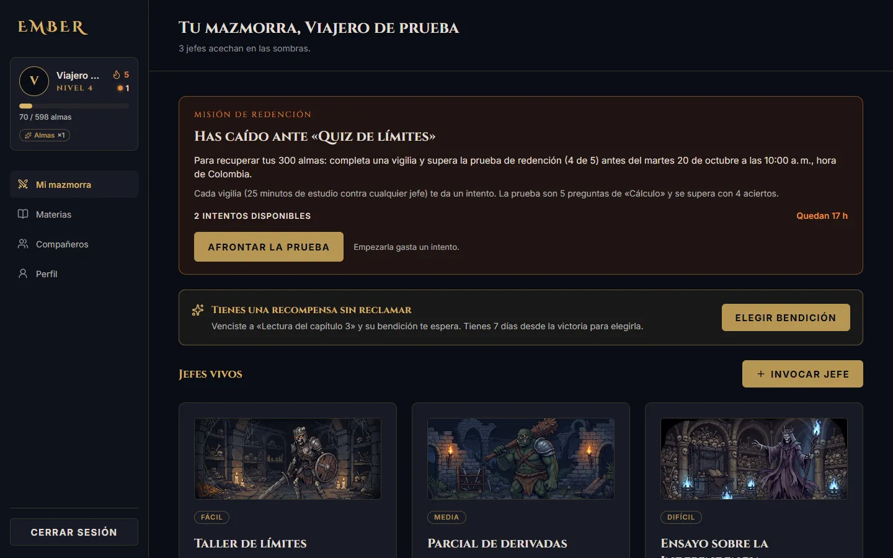
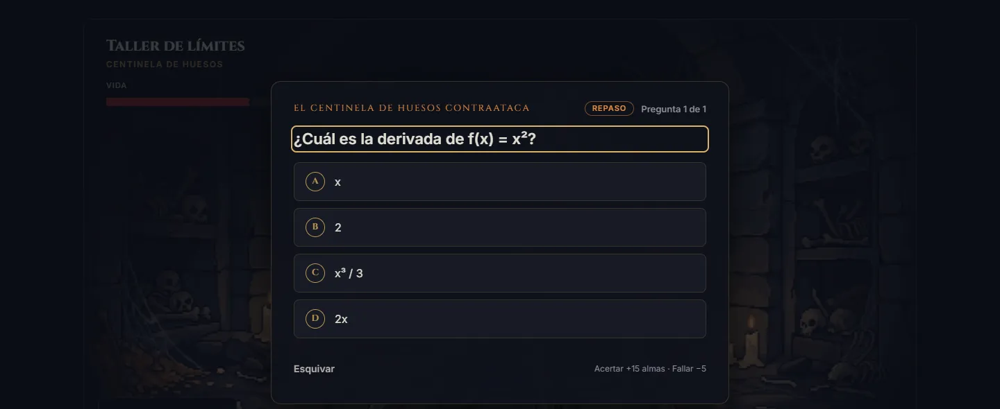
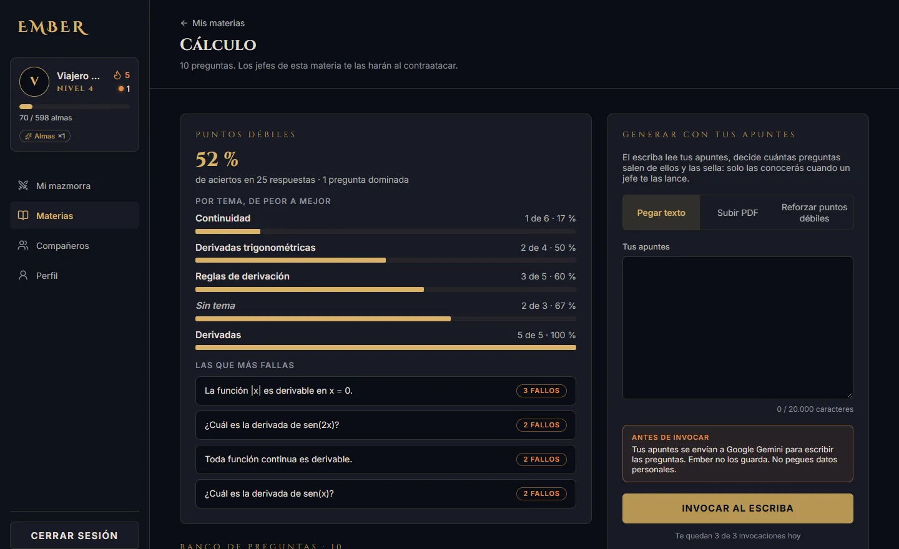
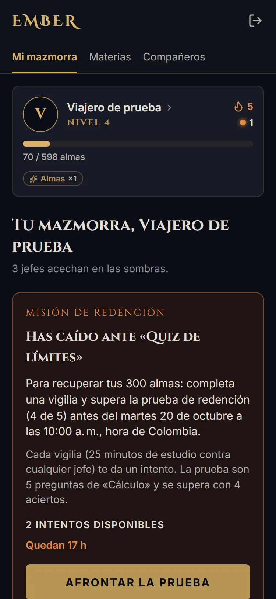
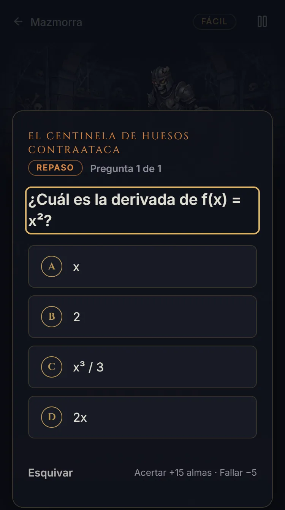
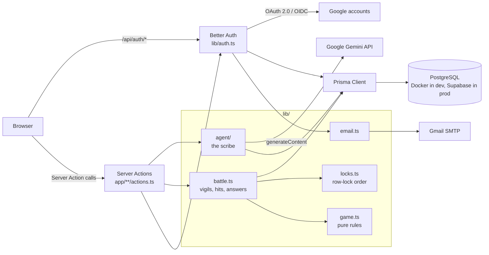

# Ember

A study app that turns deadlines into boss fights: every 25-minute focus block is a hit, and the boss strikes back with questions from your own notes.


**Live demo:** https://ember-five-taupe.vercel.app (the interface is in Spanish)


## What is Ember

Studying alone for a deadline that is still weeks away is hard to start and easy to drop. Ember gives that work a shape you can see.
Each assignment or exam becomes a boss with hit points. Each 25-minute study block, timed by the server, is one hit.
After a hit, the boss counterattacks with questions from that subject, written by you or generated from your notes by Gemini.
A daily streak (the flame) and rewards make showing up count, and a missed deadline costs souls that can only be won back by studying again.

## Features

- **Dungeon and battle:** summon bosses (name, subject, due date, difficulty) and fight them in timed vigils of 25 minutes; easy, medium and hard bosses take 2, 4 and 6 hits.
- **Counterattack:** after a hit that does not kill, the boss asks 1–3 questions (by difficulty), one at a time, with souls won or lost per answer.
- **Question bank and the scribe:** each subject has a bank of multiple-choice and true/false questions; the scribe (Google Gemini) writes 3–15 more from pasted notes or a PDF, and they stay sealed until a boss asks them.
- **Spaced review:** Leitner-style levels 0–5; a right answer brings the question back after 1, 3, 7, 14 or 30 days, a miss brings it back next time.
- **Weak points:** accuracy by topic and the questions you miss most, plus a "reinforce" mode that asks Gemini for new questions on those concepts.
- **Embers and the flame:** the flame counts consecutive days with at least one hit; embers (max 2), earned with a perfect counterattack against a medium or hard boss, cover missed days.
- **Redemption:** when a boss's due date passes, you lose the souls of your current level (never the level) and get 48 hours to win them back: each vigil earns an attempt at a 5-question trial (or, if the subject has fewer than 5 questions, two vigils are enough).
- **Roguelike rewards:** each defeated boss offers 1 of 3 blessings (six in total), and relics from bosses and flame milestones unlock titles; none of them shortens a vigil or deals damage.
- **Companions and leaderboard:** add friends by code and compare weekly hits; email addresses are never shown and stats can be hidden.
- **Profile:** vigilante name, achievements, password change, linked accounts and full account deletion.
- **Google sign-in:** OAuth through Better Auth, with account linking only when both emails are verified.

## Screenshots

| Dungeon | Counterattack |
|---|---|
|  |  |



| Dungeon at 375 px | Counterattack at 375 px |
|---|---|
|  |  |

All screenshots use the local seed account and test data.

## Tech stack

| Piece | Version | Why |
|---|---|---|
| [Next.js](https://nextjs.org) (App Router) | 16.3.8 | Server Components and Server Actions keep game rules, dice rolls and correct answers on the server, with no separate API to maintain. The landing page is static. |
| React | 19.2.8 | Pages are Server Components; client components are limited to forms (posting to Server Actions through `useActionState`), the battle and counterattack panels, and a few landing animations. |
| TypeScript | 5.9 | Shared types between the database client, the game rules and the UI. |
| Tailwind CSS | 4.3 | Colors, fonts and animations are tokens in `@theme`, so a palette change is one file. |
| PostgreSQL | 17 | Row locks (`FOR UPDATE`), partial unique indexes, `CHECK` constraints and expression indexes do the integrity work. Same major version locally (Docker) and in production (Supabase). |
| [Prisma](https://www.prisma.io) | 6.19.3 | Typed queries and versioned migrations. Pinned to 6: Prisma 7 moves the connection URLs to `prisma.config.ts`, and Supabase's guides follow 6. |
| [Better Auth](https://www.better-auth.com) | 1.7.7 (pinned) | Email and password, email verification, password reset and Google OAuth stored in the app's own database through the Prisma adapter. |
| Google Gemini (REST) | — | Structured JSON output through a plain `fetch`, with no SDK dependency. Only [`lib/agent/gemini.ts`](lib/agent/gemini.ts) knows about Google. |
| Nodemailer + Gmail SMTP | 10.0.10 (pinned) | Free for a small project. Every email goes through one function, so moving to a transactional provider means changing one file ([`lib/email.ts`](lib/email.ts)). |
| lucide-react | 1.52.0 (pinned) | Icons. |
| Vercel | — | Deploys every push to `main`; the production build also applies database migrations. |
| Docker Compose | — | A disposable Postgres for development, fully separate from production. |

## Architecture



- [`app/`](app/) holds the routes. Each private page calls `requireUser()` first, and each route's `actions.ts` is the only door from the browser into the domain code.
- [`lib/`](lib/) is the domain: [`game.ts`](lib/game.ts) (rules, no I/O), [`battle.ts`](lib/battle.ts) (transactions), [`locks.ts`](lib/locks.ts), [`agent/`](lib/agent/) (Gemini), plus auth, email, rewards, redemption and friends.
- [`prisma/`](prisma/) holds a commented schema, the migrations (with hand-written SQL where Prisma cannot express it) and the seed. [`components/`](components/) holds generic UI in `ui/` and screen pieces by area.
- [`scripts/`](scripts/) holds the `probar-*` integration tests and tooling (screenshots, hero video, browser audit, the Vercel build).

## Engineering highlights

### A single lock order, and the deadlock a foreign key caused
Every transaction that locks rows takes them in the same order: task → vigil → counterattack or trial → user → mission → the user's own rows → question. Each path is listed in [`lib/locks.ts`](lib/locks.ts).
Reviewing that order revealed a deadlock that no explicit lock explained. Skipping a question locked the question and then inserted a `QuestionAttempt`, and that insert takes `FOR KEY SHARE` on the referenced `User` row. The redemption trial locked the same two rows the other way round.
The fix was to lock the user before creating any attempt. [`scripts/probar-redencion.ts`](scripts/probar-redencion.ts) runs the old order in two concurrent transactions and checks that Postgres reports the deadlock.

### The browser never receives a correct answer
A counterattack's state lives in the database. The browser gets only the prompt and the options, shuffled with `node:crypto` (no question id, no correct index): see `publicQuestion()` in [`lib/questions/counterattack.ts`](lib/questions/counterattack.ts). It sends back "question N, shown option K", and the server maps that through the stored permutation.
Questions written by the scribe are *sealed*: the page loads only their id, type and date until a boss asks them. The "Scribe's Eye" blessing sends only the index of the option it crosses out, and the server rejects that option as an answer.

### Safe account linking with Google
Linking a Google sign-in to an existing account requires a verified email on both sides. `trustedProviders` is empty so that Better Auth never links when Google reports `email_verified: false`, and `requireLocalEmailVerified` blocks *pre-account takeover*: an attacker registers the victim's email with a password, never verifies it, and would keep that password once the victim later linked Google ([`lib/auth.ts`](lib/auth.ts)).
In that case the user is sent to "forgot password". A reset closes every session and marks the email as verified. Google tokens are never stored.

### Migrations, separate databases and RLS
Development runs against a Docker Postgres. Production migrations are applied only by the production build on Vercel ([`scripts/vercel-build.mjs`](scripts/vercel-build.mjs)), never from a laptop. The seed and every `probar-*` script stop unless both connection URLs point to localhost ([`scripts/local-only.ts`](scripts/local-only.ts)).
New columns are optional or have defaults, so the deployed code keeps working while a migration runs. Removing something takes two deploys.
Every table has Row Level Security enabled with no policies, so Supabase's public Data API cannot read it, while Prisma connects as `postgres`, which bypasses RLS. Constraints Prisma cannot express (partial unique indexes, `CHECK`, expression indexes) are written by hand in the migrations.

### The scribe: limits, retries and PDF bombs
Each user gets 3 successful generations per day. A slot is reserved before calling Gemini and confirmed after, so failed calls do not count. Input is capped at 20,000 characters or a 4 MB, 40-page PDF ([`lib/agent/rules.ts`](lib/agent/rules.ts)).
Only a 503 is retried, once, and only if at least 10 s of the 45 s budget remain. With an optional fallback model configured, that second attempt goes to the fallback instead, after a 503 or when the primary takes longer than 25 s. A 429 or any other 4xx is never retried ([`lib/agent/gemini.ts`](lib/agent/gemini.ts)).
Pages are counted without dependencies, and decompression stops at 8 MB per stream, 32 MB in total and 200 streams ([`lib/agent/pdf.ts`](lib/agent/pdf.ts)). The notes are sent inside nonce delimiters as data, not instructions. The model's output is validated with the same rules as hand-written questions, and the notes are never stored.

### Game rules as pure functions
[`lib/game.ts`](lib/game.ts) only imports types and date helpers. Functions that depend on time take `now` or `today` as an argument, and the ones that pick questions or rewards take the `shuffle` or `random` function as a parameter.
That makes the rules easy to check exhaustively. [`scripts/probar-contraataque.ts`](scripts/probar-contraataque.ts) checks that random answering scores 0 souls on average, and [`scripts/probar-brasa.ts`](scripts/probar-brasa.ts) checks that what the screen announces about the flame matches what the next hit does (`flameOutlook()` is shared by both).

## Getting started

Requirements: **Node.js 24** (the scripts run TypeScript directly with Node's type stripping) and **Docker** (Docker Desktop on Windows or macOS).

```bash
git clone https://github.com/luis243e/Ember.git
cd Ember
npm install                     # also runs prisma generate
cp .env.example .env            # then set BETTER_AUTH_SECRET (see below)
docker compose up -d            # Postgres 17 on localhost:5433
npx prisma migrate deploy       # creates the tables
npm run db:seed                 # test account: prueba@ember.test / prueba1234
npm run dev                     # http://localhost:3000
```

`.env.example` already has working development values for the database. The only required change is `BETTER_AUTH_SECRET`, for example the output of `openssl rand -base64 32`.

Everything else is optional:

| Variable | Without it |
|---|---|
| `GMAIL_USER`, `GMAIL_APP_PASSWORD` | Emails (verification, reset) are printed to the `npm run dev` console instead of sent. |
| `GEMINI_API_KEY`, `GEMINI_MODEL` | The scribe card says it is unavailable. |
| `GEMINI_MODEL_FALLBACK` | No fallback model. |
| `GOOGLE_CLIENT_ID`, `GOOGLE_CLIENT_SECRET` | The "Continue with Google" buttons are hidden. Redirect URI: `http://localhost:3000/api/auth/callback/google`. |
| `EMBER_TEST_VIGIL_SECONDS` | Vigils last 25 minutes. Set it to a few seconds to test; it is ignored in production. |
| `EMBER_FAKE_AGENT=1` | The scribe calls Gemini. With `1`, it returns sample questions without calling Google; ignored in production. |

If an antivirus intercepts TLS (sending email fails with "unable to verify the first certificate"), start Node with the system certificate store: `NODE_OPTIONS=--use-system-ca npm run dev`.

To start over: `docker compose down -v`, then repeat from `docker compose up -d`.

## Testing

The `probar-*` scripts are integration tests against the **local** database: they create temporary users, check results with real transactions, clean up after themselves and finish with `Todo bien.` or a count of failures (non-zero exit code). Run them with:

```bash
node --env-file=.env --import ./scripts/alias-hooks.mjs scripts/probar-<name>.ts
```

| Script | Covers |
|---|---|
| `probar-preguntas` | Question bank: validation rules, the question provider for counterattacks, and the hand-written `CHECK` constraints (run after `db:seed`) |
| `probar-contraataque` | Counterattack: shuffling, scoring, expected value 0, two-tab protection |
| `probar-repaso` | Spaced review: levels, due dates in Bogotá days, the SQL backfill matching `nextReview()` |
| `probar-brasa` | Embers and the flame: earning, the cap of 2, spending on a hit, the browser cannot change `embers` |
| `probar-escriba` | The scribe with the fake agent: limits, sealing, PDF checks, retries, the fallback model, what reaches the HTML |
| `probar-temas`, `probar-refuerzo` | Topics, weak points and targeted reinforcement |
| `probar-redencion` | Redemption trial, attempts, and the foreign-key deadlock of the old lock order |
| `probar-restablecer` | Password reset: one-time links, sessions closed, no email enumeration |
| `probar-perfil` | Profile, password change, account deletion cascading through every table |
| `probar-google` | Google linking rules with a fake Google provider |
| `probar-recompensas` | Blessings, offers, relics and titles |
| `probar-companeros` | Friend codes, requests, daily limit, leaderboard, no foreign ids or emails in the page |
| `probar-materias` | Unique subject names per user and renaming |
| `probar-gemini` | Real calls to Gemini (uses quota) |

Some need `npm run dev` running or `EMBER_FAKE_AGENT=1`; the header comment of each script says how to run it. Checks for the codebase as a whole:

```bash
npm run lint
npx tsc --noEmit
npm run build
```

There is no CI yet: these are run by hand before each commit.

The README screenshots are regenerated with [`scripts/capturas-readme.mjs`](scripts/capturas-readme.mjs), which signs in with the seed account against `localhost:3000` (instructions in its header comment).

## How it was built

I designed the game, the data model and the security rules, and directed and reviewed the implementation, which was written with AI assistance (Claude Code). Every decision, with its reasoning and tests, is recorded in [`docs/sesiones/`](docs/sesiones/).

## Project docs

[`docs/README.md`](docs/README.md) describes the current state, the data model, the project rules and what is pending. [`docs/sesiones/`](docs/sesiones/) is the decision log, one file per work session, with the reasoning behind each change and the tests that were run. Both are in Spanish.

## Roadmap

- Per-user time zone (today every date is computed in `America/Bogota`).
- Edit and delete bosses, spend souls, and a history of defeated and fallen bosses.
- Send email from a transactional provider with its own domain instead of a personal Gmail account, and add a global cap or captcha on sign-up emails.
- Blocking users and a cap on incoming companion requests.
- Verify the fallback model under real 503s.
- Test with a real screen reader and on Safari and iOS (Firefox and WebKit are covered by the automated browser audit).
- Resolve the `npm audit` findings in development tooling (`eslint-config-next`, `prisma`) without a forced Prisma upgrade.

## Credits

- Boss illustrations generated with Google Gemini (Nano Banana) from original prompts.
- Hero video: original animation, with the current interface composited by [`scripts/video-hero.mjs`](scripts/video-hero.mjs).
- Fonts: [Cinzel](https://fonts.google.com/specimen/Cinzel), [Cinzel Decorative](https://fonts.google.com/specimen/Cinzel+Decorative) and [Inter](https://fonts.google.com/specimen/Inter), under the SIL Open Font License 1.1.
- Icons: [Lucide](https://lucide.dev) (ISC License).

## License

Source available for review. All rights reserved.

## Author

**Luis Meza** · GitHub [@luis243e](https://github.com/luis243e) · Portfolio: [portafolioluismeza.vercel.app](https://portafolioluismeza.vercel.app)
